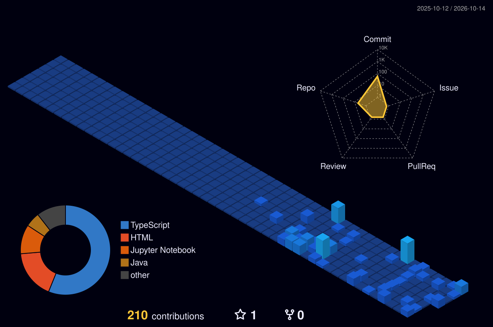

### 👋 Hi there, I'm Pham Tuan Dat!

  
  
  
  

---

### About Me

<table>
  <tr>
    <td valign="center" width="65%">
      <ul>
        <li>💼 Định hướng phát triển với tư cách là <b>AI Engineer / Machine Learning Engineer</b>.</li>
        <li>🎓 Đam mê nghiên cứu sâu về <b>Deep Learning, Generative AI & Large Language Models (LLMs)</b>.</li>
        <li>🌱 Nghiên cứu chuyên sâu về <b>Computer Vision, RAG Systems, AI Agents</b> và <b>MLOps</b>.</li>
        <li>⚡ Thích xây dựng các giải pháp ứng dụng AI vào thực tế, tối ưu hóa mô hình và triển khai hiệu năng cao.</li>
        <li>🎯 Mục tiêu: Trở thành kỹ sư AI kiến tạo các giải pháp thông minh mang lại giá trị thực tiễn.</li>
      </ul>
    </td>
    <td valign="center" align="center" width="35%">
      
    </td>
  </tr>
</table>

---

### 🛠️ Tech Stack & AI Toolkit

#### 🧠 Deep Learning, LLMs & AI Frameworks

  
  
  
  
  
  
  
  

#### 💻 Programming Languages & Data Science

  
  
  
  
  
  
  

#### ⚙️ MLOps, Cloud & Deployment

  
  
  
  
  
  
  
  

---

### 📌 What I'm currently focusing on

- 🔭 Developing **Retrieval-Augmented Generation (RAG)** systems & AI Agents
- 🔬 Experimenting with **Fine-Tuning LLMs** (LoRA, QLoRA) on domain-specific datasets
- ⚡ Optimizing model inference with **vLLM**, **ONNX Runtime**, and **TensorRT**
- 🤝 Looking to collaborate on open-source AI projects & Machine Learning research

---

### 🏢 3D Contribution Graph

  

---

### 📊 GitHub Profile Summary

   
  
   
  
  

---

### 📈 GitHub Contributions Streak

  

